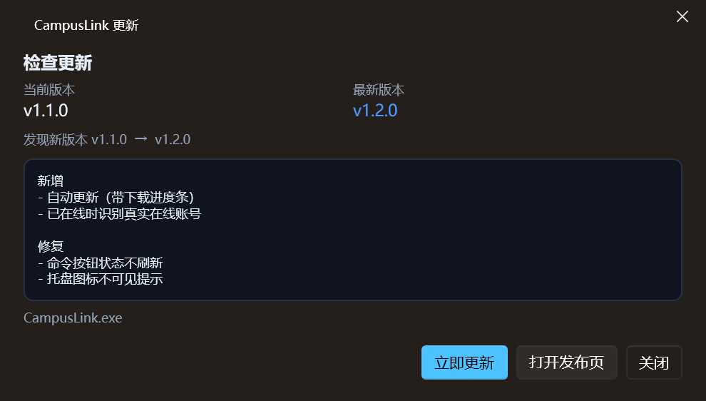

# CampusLink 校园网认证助手

面向**锐捷 SAM+ / eportal 门户**（广州大学 `http://222.201.54.55/`）的校园网认证客户端，WPF 桌面程序。


## 功能

| 模块 | 内容 |
| --- | --- |
| 核心认证 | 探测受 AC 拦截的 302 → 自动提取 `queryString` → 登录 → 按 `keepaliveInterval` 保活 → 下线 → 在线信息查询 |
| 在线身份 | MAC 免认证已在线时，从成功页取 `userIndex` 并调 `getOnlineUserInfo`，显示当前在线的**真实账号**，与本账号不一致会黄标警告 |
| MAC 无感 | 登录后调用 `registerMac` 注册无感认证；`cancelMacWithUserNameAndMac` 解绑；MAC 来自账号绑定的**网卡**，不需要手填 |
| 多账号 | 账号列表 / 切换 / 一键全部登录 / 强制下线（`logoutByUserIdAndPass`）；每个账号绑定一块网卡（决定认证 MAC 与源 IP）和独立门户地址 |
| 自动化 | 启动自动登录、掉线探测自动重连、登录后自动注册 MAC 无感 |
| 自助服务 | 只能选「账号」页里已保存的账号；抓 RSA 公钥 + 验证码图片、登录校验、默认密码检测（验证码人工识别） |
| 协议诊断 | 逐接口调用并把原始响应打印出来（排错 `queryString` / 密码加密模式 / 服务列表） |
| 自动更新 | 检查 GitHub Releases（API 限流时走发布页 302 兜底），支持启动自动检查 + 手动检查，下载带进度条，下载完自动替换重启 |
| 系统集成 | 单实例运行、托盘图标与菜单、开机自启、按天滚动日志；关闭窗口默认退出（可改为最小化到托盘） |
| 安全 | 密码用 Windows DPAPI（当前用户）加密存盘；日志自动脱敏 `password/pass/pwd/verifycode` |

## 环境与构建

- Windows 10/11，**.NET Framework 4.8**
- **需要管理员权限**：exe 的清单里写了 `requireAdministrator`，双击会弹 UAC，用于修改网卡相关状态
- Visual Studio 2026（18.x）或 MSBuild，NuGet 还原 `WPF-UI 4.3.0`、`Newtonsoft.Json 13.0.3`

```powershell
# 在 CampusLink.csproj 所在目录
msbuild CampusLink.csproj -t:Restore,Build -p:Configuration=Release
# 产物：bin\Release\CampusLink.exe
```

> 直接双击 `CampusLink.slnx` 用 VS 打开也可以，首次构建会自动还原 NuGet 包。

## 分发方式（安装程序 + 更新包）

一条命令生成两种产物：

```powershell
# 在仓库根目录
powershell -ExecutionPolicy Bypass -File tools\package.ps1
```

| 产物 | 用途 |
| --- | --- |
| `dist\CampusLink-Setup-<版本>.exe` | **首次安装**：Inno Setup 安装程序，安装到 `Program Files\CampusLink`，创建开始菜单/可选桌面快捷方式，带卸载器 |
| `dist\CampusLink-<版本>-win.zip` | **自动更新**：整个程序目录（exe + 依赖 dll + config），更新器解压后整目录覆盖 |

- 自动更新只认 **zip**；`Setup.exe` 会被忽略（避免把安装器当成主程序覆盖）。
- 依赖：Windows 10/11 自带 .NET Framework 4.8；编译安装程序需要 Inno Setup 6（`winget install JRSoftware.InnoSetup`），没有时脚本只出 zip。
- 发布 Release 时把 **Setup.exe 和 zip 一起上传**：新用户装 Setup，老用户自动更新走 zip。

## 快速上手

1. 电脑连上校园网，**先不要用浏览器登录**。
2. 「账号」页 → 左上角 **添加账号**：填学号、密码，在「认证网卡」里选中你正在联网的那块网卡，门户地址默认 `222.201.54.55`。
3. 保存后点卡片上的 **登录**。成功后可再点 **无感注册**，让该网卡的 MAC 之后长期直通。
4. 要改账号：点卡片上的 **编辑**；要删账号：进编辑面板后点 **删除账号**（会二次确认）。
5. 需要常驻：在「设置」里打开 **开机自动启动**、**关闭窗口时最小化到托盘**、**掉线自动重连**。

> 如果门户已经显示「已在线（AC 返回成功页）」，说明这个 MAC 已经在免认证状态，**此时程序不会校验账号密码**，卡片会显示 `在线·免认证`。

## 界面

| 页面 | 作用 |
| --- | --- |
| 账号 | 账号卡片（登录/下线/探测/编辑/无感注册/解绑/在线信息）；默认只显示卡片列表，点「添加账号」或「编辑」才弹出表单 |
| 自助服务 | 从已保存账号里选一个 → 取验证码 → RSA 登录校验 / 默认密码检测，一键打开自助服务网站 |
| 协议诊断 | 探测 queryString、pageInfo、登录页字段与 RSA 公钥、getServices、getOnlineUserInfo，原始响应可复制 |
| 运行日志 | 实时日志列表、清空、打开日志目录 |
| 设置 | 探测地址、密码加密模式、RSA 分隔符、自动重连间隔、开机自启、托盘行为、自助服务地址 |
| 关于 | 版本信息、作者社交媒体、赞助码、说明与免责 |

### 登录状态语义（重要）

| 卡片状态 | 含义 |
| --- | --- |
| `在线` | 真的走通了 `login` 接口，拿到 `userIndex`，账号密码已通过门户校验 |
| `在线·免认证` | 门户返回 `redirectortosuccess.jsp`，说明这块 MAC 已被 AC 放行；程序会继续查当前在线的**真实账号**并标注「本账号 / 非本账号」，但**没有校验密码** |
| `待认证` | 拿到了 `queryString`，还没登录 |
| `离线` / `异常` | 已下线 / 探测失败或接口报错 |

> `在线·免认证` 时卡片会显示形如 `在线账号 2023xxxx（本账号）` 或 `⚠ 当前在线的是账号 2023xxxx，不是本账号`。这是从 `success.jsp?userIndex=` 解出来的：`userIndex` 是 `会话_IP_学号` 的十六进制。

想验证某个账号的密码对不对，请用「自助服务 → 登录校验」（需要输验证码）；在该 MAC 已注册无感的前提下，直接点「登录」是不会触发密码校验的。


## 协议实现要点

统一入口：`POST http://<门户>/eportal/InterFace.do?method=<method>`，表单提交。

| 接口 | 方法 | 编码 |
| --- | --- | --- |
| 探测 | `GET http://<门户>/`（或自定义探测地址），读取原始 302 的 `Location`，取 `index.jsp?` 之后的查询串 | 原始串，不伪造 |
| 登录 | `login` | `userId` / `password` / `service` / `queryString` / `validcode` 走**双重 `encodeURIComponent`**；成功后保存 `userIndex`、`keepaliveInterval` |
| 保活 | `keepalive` | `userIndex` 单次编码，按 `keepaliveInterval` 周期调用（默认 120s） |
| 下线 | `logout` / `logoutByUserIdAndPass` | 单次编码 |
| 无感 | `registerMac` / `cancelMacWithUserNameAndMac` | `mac` 归一化为 12 位大写十六进制 |
| 只读 | `pageInfo` / `getServices` / `getOnlineUserInfo` | `queryString` / `userIndex` |

响应解析：优先 `JObject.Parse`，失败时截取 `{...}` 重试，再失败用正则抠 `"result":"..."`；文本优先严格 UTF-8，失败回退 GB18030（门户页面是 GBK）。

### 密码加密（`passwordEncrypt`）

- **自动**：读取 `index.jsp` 隐藏字段 `passwordEncrypt`、`publicKeyExponent`、`publicKeyModulus` 后决定明文或 RSA。
- **强制明文 / 强制 RSA**：当自动判断和现场不一致时手动切换。
- RSA 复刻门户前端 `RSAUtils.encryptedString`：`密码 + 分隔符 + MAC` → 整串反转 → 按 16 位 digit 小端分块 → 无填充 `ModPow` → 定长十六进制。
- 分隔符资料里出现过 `>` 和 `>>` 两种，默认 `>`，可在设置里改。

> 资料未确认广大现场的真实取值。先用「自动」，登录报密码错误时到「协议诊断 → 登录页字段 / RSA」看实际返回再切换。

## 自助服务（222.201.54.23:8080）

- 登录接口强制 RSA（反转密码后加密）且**必须带验证码**，因此本工具把验证码图片直接画在界面上，人工输入后提交。
- 登录成功/失败判定与 `campus_selfcheck.py` 一致：`index_self.jsf` = 成功、`verifyError=true` = 验证码错、其他 `errorMsg` = 账号密码错。
- 「检测默认密码」用模板（默认 `{uid}@Gzhu`）真登录一次：能登进去说明**默认密码没改**。
- 改密、余额等页面是登录后的 JSF 动态页，未做接口化，点「打开自助服务」在浏览器里操作最稳。

## 自动更新

项目主页：<https://github.com/Thomas455/CampusLink>（GitCode 镜像：<https://gitcode.com/Thomas455/CampusLink>）

- **检查顺序**：先 **GitCode**，再 **GitHub**，两个源各自检查，取版本号最高的那个；同版本时优先 GitCode，并把另一个源的附件作为下载备选。
- **每个源的检查方式**：
  - GitCode：`https://api.gitcode.com/api/v5/repos/Thomas455/CampusLink/releases`（列表，匿名可读）
  - GitHub：`https://api.github.com/repos/Thomas455/CampusLink/releases/latest`
  - GitHub API 失败时走 `releases/latest` 的 302 跳转兜底
  - 都拿不到时用 git 的 `info/refs` 读 tag（只提示版本，没有附件）
- **代理**：更新请求走**系统代理**（有 Clash 等代理时能访问 GitHub），校园网门户请求仍直连。
- **发布约定**（两个平台都要照做，否则自动更新拿不到安装包）：
  - tag 用 `vX.Y.Z`，例如 `v1.2.0`
  - **更新包**：上传 `CampusLink-<版本>-win.zip`（整个程序目录，由 `tools\package.ps1` 生成）
  - **安装包**：上传 `CampusLink-Setup-<版本>.exe`（新用户用；更新器会忽略它）
  - 只上传单文件 `CampusLink.exe` 也可作为兜底（但依赖 DLL 有变化时必须给 zip）
- **UI**：发现新版本 → 主窗口顶部绿色提示条（可「忽略」）+ 托盘气泡；「关于」页可手动检查、查看发布说明、带进度条下载。
- **安装**：下载 zip 到 `%TEMP%` 并解包，写一个带重试的 `.cmd`，等主进程退出后**整目录覆盖**（robocopy）并重新启动；账号配置不动。
- **启动检查**：默认开启，且 6 小时内最多检查一次（可在设置里调整间隔/关闭）。
- **镜像/离线测试**：环境变量 `CAMPUSLINK_GITCODE_API` / `CAMPUSLINK_GITCODE_WEB`（GitCode）、`CAMPUSLINK_UPDATE_API` / `CAMPUSLINK_UPDATE_WEB`（GitHub）可指向镜像或本地 mock。



## 数据与安全

```
%APPDATA%\CampusLink\
├─ accounts.json   账号配置（密码字段为 DPAPI 密文）
├─ settings.json   全局设置
└─ logs\YYYYMMDD.log
```

- 密码使用 `ProtectedData.Protect(..., DataProtectionScope.CurrentUser)`，换机器/换用户无法解密。
- 日志写入前对 `password/pass/pwd/verifycode` 做脱敏。
- 认证接口本身没有签名/token，请勿把账号密码提交到公开仓库。

## 常见问题

| 现象 | 原因 / 处理 |
| --- | --- |
| `WEB认证设备未注册…` | `queryString` 无效或过期。到「协议诊断 → 探测」重新抓一次，别复用旧值 |
| `用户名或密码错误` | 凭据错，或密码加密模式不对。先用「自动」，不行再试强制明文 / 强制 RSA，并核对分隔符 |
| 提示需要验证码 | 弹窗会显示验证码图片，照图输入；失败会刷新图片重试 |
| 登录成功但很快掉线 | 密码复杂度不足（`PWD_COMPLEX_OFFLINE_WEB`），去自助服务改密 |
| 注册了 MAC 还弹认证 | 先「解绑 MAC」再重新注册；确认账号绑定的网卡就是实际联网的那块 |
| 探不到 queryString | 可能已经在线，或当前不在校园网。门户根返回 `redirectortosuccess.jsp` 就代表在线 |
| 乱输密码也显示「在线」 | 这是 `在线·免认证`：该 MAC 已被 AC 放行，门户没校验密码。卡片会显示当前真正在线的账号；若与本账号不符会有黄色警告 |
| 卡片显示「在线账号 xxx（非本账号）」 | 说明当前这块网卡上的会话属于别的账号。要切回本账号：先「强制下线全部」，再「登录」 |
| 保存设置/账号后网络请求变多 | 这是设计行为：保存后会主动探测并同步一次账号状态 |
| 提示「需要管理员权限」 | 程序清单要求管理员运行，用于网卡相关操作；右键「以管理员身份运行」或直接双击弹 UAC 确认即可 |
| 检查更新提示「仓库还没有发布版本」 | 先在 GitHub 发一个 Release（tag 形如 `v1.2.0`，附件放 `CampusLink.exe`） |
| 更新后版本没变 | 确认 Release 的 tag 大于当前版本（关于页显示），且附件名符合约定 |
| 更新下载失败 | 检查网络/代理；GitHub 下载地址被墙时可在 `设置` 或环境变量里改用镜像 |
| 看不到托盘图标 | Windows 11 默认把新图标收进任务栏「^ 隐藏的图标」。设置 → 个性化 → 任务栏 → 其他系统托盘图标 → 打开 CampusLink；程序内「设置」页也有直达按钮 |
| 设置了开机自启但没生效 | 检查 `HKCU\Software\Microsoft\Windows\CurrentVersion\Run` 是否有 `CampusLink` 值 |
| 双击 exe 没反应 | 程序是单实例的：已有实例在跑时会直接把它的窗口唤到前台 |
| 关闭窗口程序就没了 | 默认关闭即退出；要常驻请在「设置」里勾选「关闭窗口时最小化到托盘」 |

## 目录结构

```
CampusLink/
├─ CampusLink.csproj / CampusLink.slnx / app.manifest（requireAdministrator + PerMonitorV2 DPI）
├─ App.xaml(.cs) / MainWindow.xaml(.cs)
├─ Models/          账号（含网卡绑定）、设置、会话状态、接口结果
├─ Services/        HttpTransport、PortalClient、RuijieRsa、SelfServiceClient、
│                   AccountStore、KeepaliveService、AutoReconnectService、
│                   StartupService、TrayService、NetworkAdapterService、ShellHelper、UpdateService
├─ ViewModels/      Main / AccountItem / Settings / SelfService / Diagnostics / About / Update
├─ Views/           AccountsPage / SelfServicePage / DiagnosticsPage / LogsPage /
│                   SettingsPage / AboutPage / CaptchaDialog / UpdateDialog
├─ Infrastructure/  ObservableObject、RelayCommand、LogService、JsonHelper、UiDispatcher、
│                   SingleInstance、ValueConverters
└─ Resources/       app-icon.svg（矢量源）、app.ico（多尺寸）、app-icon-256.png、sponsor.jpg
```

## 图标

`Resources/app-icon.svg` 是矢量源（渐变圆角方块 + WiFi 信号 + 认证对勾）。构建产物 `app.ico` 由该 SVG 渲染出 16/20/24/32/40/48/64/128/256 多尺寸，同时用于 exe 图标、窗口图标和托盘图标。

重新生成（需要 Node.js + sharp）：

```bash
npm i sharp
node ..\tools\build-icon.js Resources\app-icon.svg Resources
```

## 免责声明

本工具仅用于你本人或已获授权管理的账号，自动化请求都以本机、本账号发出。请遵守学校网络使用规定，不要用它批量尝试他人账号。
