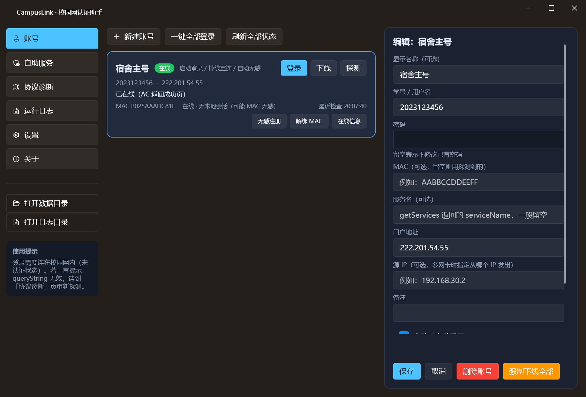
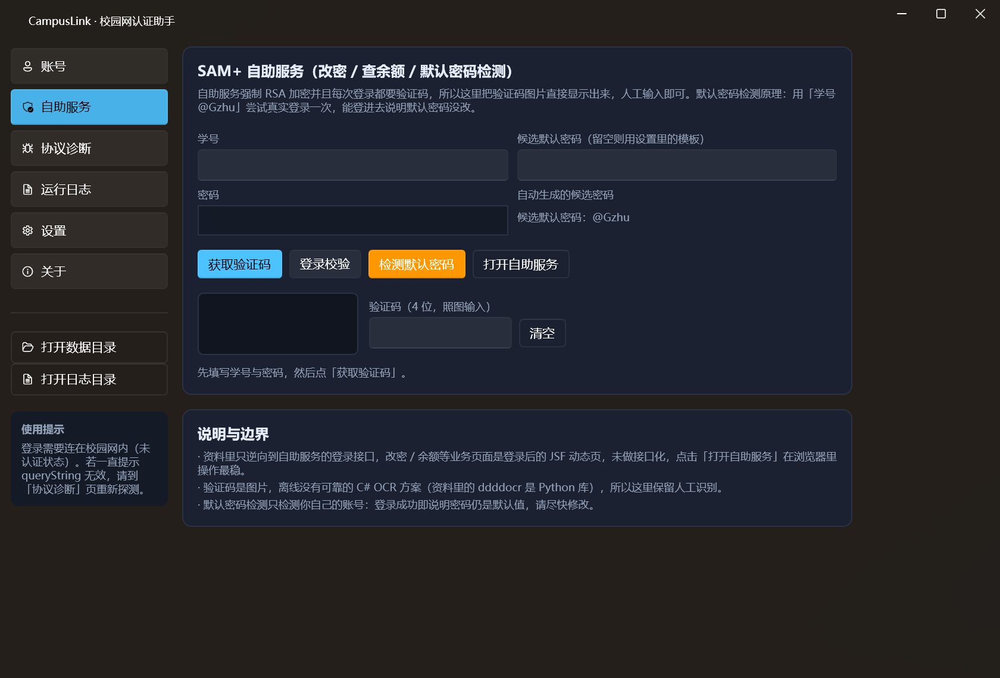

# CampusLink 校园网认证助手

面向**锐捷 SAM+ / eportal 门户**（广州大学 `http://222.201.54.55/`）的校园网认证客户端，WPF 桌面程序。



## 功能

| 模块 | 内容 |
| --- | --- |
| 核心认证 | 探测受 AC 拦截的 302 → 自动提取 `queryString` → 登录 → 按 `keepaliveInterval` 保活 → 下线 → 在线信息查询 |
| MAC 无感 | 登录后调用 `registerMac` 注册无感认证；`cancelMacWithUserNameAndMac` 解绑 |
| 多账号 | 账号列表 / 切换 / 一键全部登录 / 强制下线（`logoutByUserIdAndPass`）；每个账号可独立配置门户地址与源 IP |
| 自动化 | 启动自动登录、掉线探测自动重连、登录后自动注册 MAC 无感 |
| 自助服务 | 抓 RSA 公钥 + 验证码图片、登录校验、默认密码检测（验证码人工识别） |
| 协议诊断 | 逐接口调用并把原始响应打印出来（排错 `queryString` / 密码加密模式 / 服务列表） |
| 系统集成 | 托盘图标与菜单、开机自启、关闭/最小化到托盘、按天滚动日志 |
| 安全 | 密码用 Windows DPAPI（当前用户）加密存盘；日志自动脱敏 `password/pass/pwd/verifycode` |

## 环境与构建

- Windows 10/11，**.NET Framework 4.8**
- Visual Studio 2026（18.x）或 MSBuild，NuGet 还原 `WPF-UI 4.3.0`、`Newtonsoft.Json 13.0.3`

```powershell
# 在 CampusLink.csproj 所在目录
msbuild CampusLink.csproj -t:Restore,Build -p:Configuration=Release
# 产物：bin\Release\CampusLink.exe
```

> 直接双击 `CampusLink.slnx` 用 VS 打开也可以，首次构建会自动还原 NuGet 包。

## 快速上手

1. 电脑连上校园网，**先不要用浏览器登录**。
2. 「账号」页 → **新建账号**：填学号、密码，门户地址默认 `222.201.54.55`。
3. 点卡片上的 **登录**。成功后可再点 **无感注册**，让本机 MAC 之后长期直通。
4. 需要常驻：在「设置」里打开 **开机自动启动**、**关闭窗口时最小化到托盘**、**掉线自动重连**。

> 如果门户已经显示「已在线（AC 返回成功页）」，说明这个 MAC 已经在免认证状态，不需要再登录。

## 界面

| 页面 | 作用 |
| --- | --- |
| 账号 | 账号卡片、登录/下线/探测/无感注册/解绑/在线信息、账号编辑面板 |
| 自助服务 | 取验证码 → RSA 登录校验 / 默认密码检测，一键打开自助服务网站 |
| 协议诊断 | 探测 queryString、pageInfo、登录页字段与 RSA 公钥、getServices、getOnlineUserInfo，原始响应可复制 |
| 运行日志 | 实时日志列表、清空、打开日志目录 |
| 设置 | 探测地址、密码加密模式、RSA 分隔符、自动重连间隔、开机自启、托盘行为、自助服务地址 |
| 关于 | 版本信息、作者社交媒体、赞助码、说明与免责 |



## 协议实现要点

统一入口：`POST http://<门户>/eportal/InterFace.do?method=<method>`，表单提交。

| 接口 | 方法 | 编码 |
| --- | --- | --- |
| 探测 | `GET http://<门户>/`（或自定义探测地址），读取原始 302 的 `Location`，取 `index.jsp?` 之后的查询串 | 原始串，不伪造 |
| 登录 | `login` | `userId` / `password` / `service` / `queryString` / `validcode` 走**双重 `encodeURIComponent`**；成功后保存 `userIndex`、`keepaliveInterval` |
| 保活 | `keepalive` | `userIndex` 单次编码，按 `keepaliveInterval` 周期调用（默认 120s） |
| 下线 | `logout` / `logoutByUserIdAndPass` | 单次编码 |
| 无感 | `registerMac` / `cancelMacWithUserNameAndMac` | `mac` 归一化为 12 位大写十六进制 |
| 只读 | `pageInfo` / `getServices` / `getOnlineUserInfo` | `queryString` / `userIndex` |

响应解析：优先 `JObject.Parse`，失败时截取 `{...}` 重试，再失败用正则抠 `"result":"..."`；文本优先严格 UTF-8，失败回退 GB18030（门户页面是 GBK）。

### 密码加密（`passwordEncrypt`）

- **自动**：读取 `index.jsp` 隐藏字段 `passwordEncrypt`、`publicKeyExponent`、`publicKeyModulus` 后决定明文或 RSA。
- **强制明文 / 强制 RSA**：当自动判断和现场不一致时手动切换。
- RSA 复刻门户前端 `RSAUtils.encryptedString`：`密码 + 分隔符 + MAC` → 整串反转 → 按 16 位 digit 小端分块 → 无填充 `ModPow` → 定长十六进制。
- 分隔符资料里出现过 `>` 和 `>>` 两种，默认 `>`，可在设置里改。

> 资料未确认广大现场的真实取值。先用「自动」，登录报密码错误时到「协议诊断 → 登录页字段 / RSA」看实际返回再切换。

## 自助服务（222.201.54.23:8080）

- 登录接口强制 RSA（反转密码后加密）且**必须带验证码**，因此本工具把验证码图片直接画在界面上，人工输入后提交。
- 登录成功/失败判定与 `campus_selfcheck.py` 一致：`index_self.jsf` = 成功、`verifyError=true` = 验证码错、其他 `errorMsg` = 账号密码错。
- 「检测默认密码」用模板（默认 `{uid}@Gzhu`）真登录一次：能登进去说明**默认密码没改**。
- 改密、余额等页面是登录后的 JSF 动态页，未做接口化，点「打开自助服务」在浏览器里操作最稳。

## 数据与安全

```
%APPDATA%\CampusLink\
├─ accounts.json   账号配置（密码字段为 DPAPI 密文）
├─ settings.json   全局设置
└─ logs\YYYYMMDD.log
```

- 密码使用 `ProtectedData.Protect(..., DataProtectionScope.CurrentUser)`，换机器/换用户无法解密。
- 日志写入前对 `password/pass/pwd/verifycode` 做脱敏。
- 认证接口本身没有签名/token，请勿把账号密码提交到公开仓库。

## 常见问题

| 现象 | 原因 / 处理 |
| --- | --- |
| `WEB认证设备未注册…` | `queryString` 无效或过期。到「协议诊断 → 探测」重新抓一次，别复用旧值 |
| `用户名或密码错误` | 凭据错，或密码加密模式不对。先用「自动」，不行再试强制明文 / 强制 RSA，并核对分隔符 |
| 提示需要验证码 | 弹窗会显示验证码图片，照图输入；失败会刷新图片重试 |
| 登录成功但很快掉线 | 密码复杂度不足（`PWD_COMPLEX_OFFLINE_WEB`），去自助服务改密 |
| 注册了 MAC 还弹认证 | MAC 格式不对或绑定被顶掉：先「解绑 MAC」再重新注册 |
| 探不到 queryString | 可能已经在线，或当前不在校园网。门户根返回 `redirectortosuccess.jsp` 就代表在线 |
| 设置了开机自启但没生效 | 检查 `HKCU\Software\Microsoft\Windows\CurrentVersion\Run` 是否有 `CampusLink` 值 |

## 目录结构

```
CampusLink/
├─ CampusLink.csproj / CampusLink.slnx
├─ App.xaml(.cs) / MainWindow.xaml(.cs)
├─ Models/          账号、设置、会话状态、接口结果
├─ Services/        HttpTransport、PortalClient、RuijieRsa、SelfServiceClient、
│                   AccountStore、KeepaliveService、AutoReconnectService、
│                   StartupService、TrayService
├─ ViewModels/      Main / AccountItem / Settings / SelfService / Diagnostics / About
├─ Views/           AccountsPage / SelfServicePage / DiagnosticsPage / LogsPage /
│                   SettingsPage / AboutPage / CaptchaDialog
├─ Infrastructure/  ObservableObject、RelayCommand、LogService、JsonHelper、UiDispatcher
└─ Resources/       app-icon.svg（矢量源）、app.ico（多尺寸）、app-icon-256.png、sponsor.jpg
```

## 图标

`Resources/app-icon.svg` 是矢量源（渐变圆角方块 + WiFi 信号 + 认证对勾）。构建产物 `app.ico` 由该 SVG 渲染出 16/20/24/32/40/48/64/128/256 多尺寸，同时用于 exe 图标、窗口图标和托盘图标。

重新生成（需要 Node.js + sharp）：

```bash
npm i sharp
node ..\tools\build-icon.js Resources\app-icon.svg Resources
```

## 免责声明

本工具仅用于你本人或已获授权管理的账号，自动化请求都以本机、本账号发出。请遵守学校网络使用规定，不要用它批量尝试他人账号。
