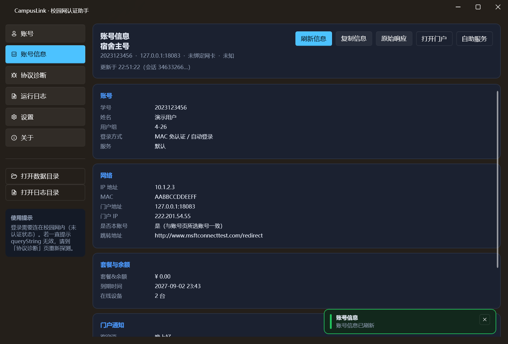
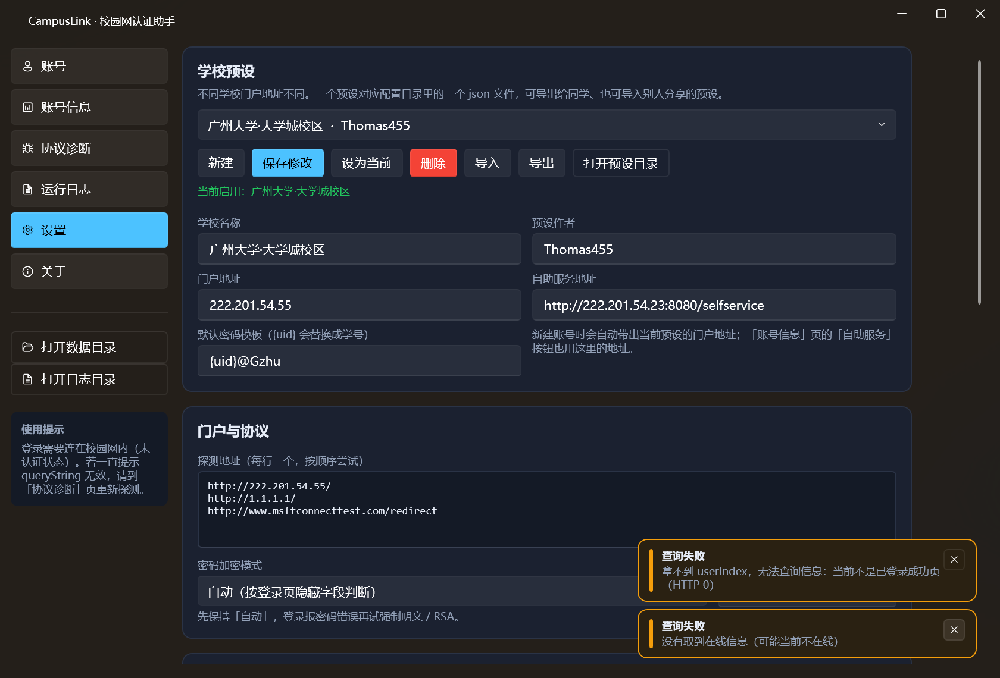

# CampusLink 校园网认证助手

面向**锐捷 SAM+ / eportal 门户**（广州大学大学城校区 `http://222.201.54.55/`）的校园网认证客户端，WPF 桌面程序。


## 功能

| 模块 | 内容 |
| --- | --- |
| 核心认证 | 探测受 AC 拦截的 302 → 自动提取 `queryString` → 登录 → 按 `keepaliveInterval` 保活 → 下线 → 在线信息查询 |
| 在线身份 | MAC 免认证已在线时，从成功页取 `userIndex` 并调 `getOnlineUserInfo`，识别当前在线的**真实账号**，与本账号不一致会黄标警告 |
| 账号信息 | 按 `userIndex` 调 `getOnlineUserInfo`，把账号、网络、套餐/余额（`ballInfo`）、门户通知、会话等字段**结构化展示**，支持复制与查看原始响应 |
| 学校预设 | 内置「广州大学·大学城校区」；可新建/保存/设为当前/删除，支持导入导出（一个预设 = 配置目录里的一个 json） |
| MAC 无感 | 登录后调用 `registerMac` 注册无感认证；`cancelMacWithUserNameAndMac` 解绑；MAC 来自账号绑定的**网卡**，不需要手填 |
| 多账号 | 账号列表 / 切换 / 一键全部登录 / 强制下线（`logoutByUserIdAndPass`）；每个账号绑定一块网卡（决定认证 MAC 与源 IP）和独立门户地址 |
| 自动化 | 启动自动登录、掉线探测自动重连、登录后自动注册 MAC 无感 |
| 通知 | 窗口右下角弹出，按**绿（成功）/ 黄（注意）/ 红（失败）/ 蓝（信息）**分级，自动消失，可手动关闭 |
| 协议诊断 | 逐接口调用并把原始响应打印出来（排错 `queryString` / 密码加密模式 / 服务列表） |
| 自动更新 | 先 GitCode 再 GitHub，取版本最高者；支持启动检查 + 手动检查，进度条下载，整包覆盖安装 |
| CI/CD | GitHub Actions：打 `v*` tag 自动构建、打包 zip + Setup、创建 Release |
| 系统集成 | 单实例运行、托盘图标与菜单、开机自启、按天滚动日志 |
| 安全 | 密码 DPAPI 加密；日志里**不出现完整学号**，只显示账号显示名称或学号后 3 位 |

## 环境与构建

- Windows 10/11，**.NET Framework 4.8**
- **需要管理员权限**：exe 清单 `requireAdministrator`（修改网卡相关状态），双击会弹 UAC
- Visual Studio 2026（18.x）或 MSBuild；NuGet 还原 `WPF-UI 4.3.0`、`Newtonsoft.Json 13.0.3`

```powershell
# 在 CampusLink.csproj 所在目录
msbuild CampusLink.csproj -t:Restore,Build -p:Configuration=Release
# 产物：bin\Release\CampusLink.exe
```

## 分发方式（安装程序 + 更新包）

一条命令生成两种产物：

```powershell
# 在仓库根目录
powershell -ExecutionPolicy Bypass -File tools\package.ps1
```

| 产物 | 用途 |
| --- | --- |
| `dist\CampusLink-Setup-<版本>.exe` | **首次安装**：Inno Setup 安装程序，安装到 `Program Files\CampusLink`，创建开始菜单/可选桌面快捷方式，带卸载器 |
| `dist\CampusLink-<版本>-win.zip` | **自动更新**：整个程序目录（exe + 依赖 dll + config），更新器解压后整目录覆盖 |

- 自动更新只认 **zip**；`Setup.exe` 会被忽略（避免把安装器当成主程序覆盖）。
- 编译安装程序需要 Inno Setup 6；没有时脚本只出 zip。
- 发布 Release 时把 **Setup.exe 和 zip 一起上传**：新用户装 Setup，老用户自动更新走 zip。

### GitHub Actions 自动发布

工作流：`.github/workflows/main.yml`

- 推送 `v*` tag（如 `v1.3.0`）→ 自动恢复依赖、Release 构建、生成 zip + Setup、创建 GitHub Release 并上传两个附件。
- `workflow_dispatch` 手动触发 → 只构建并上传 CI artifact（不创建 Release）。
- 构建前会把 `AssemblyInfo.cs` 的版本改成 tag 里的版本，保证「关于页显示的版本」和 tag 一致，自动更新不会反复提示同一个版本。

```bash
git tag v1.3.0
git push origin v1.3.0
```

## 快速上手

1. 电脑连上校园网，**先不要用浏览器登录**。
2. 「设置 → 学校预设」确认当前启用的是「广州大学·大学城校区」（首次启动会自动启用）。
3. 「账号」页 → **添加账号**：填学号、密码，选一块正在联网的网卡；门户地址会按当前预设自动带出。
4. 保存后点卡片上的 **登录**；成功后可再点 **无感注册**，让该网卡的 MAC 之后长期直通。
5. 要改账号：点卡片上的 **编辑**；删除账号在编辑面板里点 **删除账号**（二次确认）。
6. 看当前网络的详细信息：「账号信息」页 → **刷新信息**。
7. 常驻使用：设置里打开 **开机自动启动**、**关闭窗口时最小化到托盘**、**掉线自动重连**。

> 如果门户已经显示「已在线（AC 返回成功页）」，说明这个 MAC 已在免认证状态，**此时点「登录」不会校验密码**，卡片显示 `在线·免认证`。

## 界面

| 页面 | 作用 |
| --- | --- |
| 账号 | 账号卡片（登录/下线/探测/编辑/无感注册/解绑/在线信息）；点「添加账号」或「编辑」才展开表单 |
| 账号信息 | 自动按 userIndex 取 `getOnlineUserInfo`，结构化展示账号、网络、套餐/余额、门户通知、会话；可复制、查看原始 JSON、打开门户/自助服务 |
| 协议诊断 | 探测 queryString、pageInfo、登录页字段与 RSA 公钥、getServices、getOnlineUserInfo，原始响应可复制 |
| 运行日志 | 实时日志列表、清空、打开日志目录（账号只显示名称或后 3 位） |
| 设置 | 学校预设管理、探测地址、密码加密模式、RSA 分隔符、自动重连、开机自启、托盘行为、更新 |
| 关于 | 版本信息、作者社交媒体、赞助码、检查更新、说明与免责 |

### 账号信息页



- 拿 `userIndex` 的顺序：本地会话 → 从 `redirectortosuccess.jsp` 的 302 `success.jsp?userIndex=` 自动发现。
- 字段分组：**账号**（学号/姓名/用户组/登录方式/服务）、**网络**（IP/MAC/门户/门户 IP/是否本账号/跳转地址）、**套餐与余额**（`money` / `periodtime` / `deviceNum` 等）、**门户通知**、**会话**。
- `ballInfo` 是「JSON 数组的字符串」，程序会二次解析并按类型格式化（金额加 ¥、时间戳转本地时间、设备数加「台」）。

### 登录状态语义（重要）

| 卡片状态 | 含义 |
| --- | --- |
| `在线` | 真的走通了 `login` 接口，拿到 `userIndex`，账号密码已通过门户校验 |
| `在线·免认证` | 门户返回 `redirectortosuccess.jsp`，这块 MAC 已被 AC 放行；程序会识别当前在线的**真实账号**并标注「本账号 / 非本账号」，但**没有校验密码** |
| `待认证` | 拿到了 `queryString`，还没登录 |
| `离线` / `异常` | 已下线 / 探测失败或接口报错 |

> `在线·免认证` 时卡片显示「当前在线账号与本账号一致」或「⚠ 当前在线的是其他账号 ***108」。这是从 `success.jsp?userIndex=` 解出来的：`userIndex` 是 `会话_IP_学号` 的十六进制。

## 协议实现要点

统一入口：`POST http://<门户>/eportal/InterFace.do?method=<method>`，表单提交。

| 接口 | 方法 | 编码 |
| --- | --- | --- |
| 探测 | `GET http://<门户>/`（或自定义探测地址），读取原始 302 的 `Location`，取 `index.jsp?` 之后的查询串 | 原始串，不伪造 |
| 登录 | `login` | `userId` / `password` / `service` / `queryString` / `validcode` 走**双重 `encodeURIComponent`**；成功后保存 `userIndex`、`keepaliveInterval` |
| 保活 | `keepalive` | `userIndex` 单次编码，按 `keepaliveInterval` 周期调用（默认 120s） |
| 下线 | `logout` / `logoutByUserIdAndPass` | 单次编码 |
| 无感 | `registerMac` / `cancelMacWithUserNameAndMac` | `mac` 归一化为 12 位大写十六进制 |
| 只读 | `pageInfo` / `getServices` / `getOnlineUserInfo` | `queryString` / `userIndex` |

响应解析：优先 `JObject.Parse`，失败时截取 `{...}` 重试，再失败用正则抠 `"result":"..."`；文本优先严格 UTF-8，失败回退 GB18030（门户页面是 GBK）。

### 密码加密（`passwordEncrypt`）

- **自动**：读取 `index.jsp` 隐藏字段 `passwordEncrypt`、`publicKeyExponent`、`publicKeyModulus` 后决定明文或 RSA。
- **强制明文 / 强制 RSA**：当自动判断和现场不一致时手动切换。
- RSA 复刻门户前端 `RSAUtils.encryptedString`：`密码 + 分隔符 + MAC` → 整串反转 → 按 16 位 digit 小端分块 → 无填充 `ModPow` → 定长十六进制。
- 分隔符资料里出现过 `>` 和 `>>` 两种，默认 `>`，可在设置里改。

> 资料未确认广大现场的真实取值。先用「自动」，登录报密码错误时到「协议诊断 → 登录页字段 / RSA」看实际返回再切换。

## 学校预设

不同学校的认证门户地址不同，所以把「学校相关」的配置抽成预设：

| 字段 | 说明 |
| --- | --- |
| 学校名称 | 显示名称，也是预设文件名 |
| 预设作者 | 方便分享时标注来源 |
| 门户地址 | 认证门户，例如 `222.201.54.55` |
| 自助服务地址 | 「账号信息」页里「自助服务」按钮打开的地址 |
| 默认密码模板 | `{uid}` 会替换成学号，例如 `{uid}@Gzhu` |

- 存储位置：`%APPDATA%\CampusLink\presets\<id>.json`，一个预设一个文件。
- 内置「广州大学·大学城校区」（作者 Thomas455），文件丢失会在下次启动时自动恢复。
- 「设为当前」后，新建账号会自动带出该预设的门户地址；导入别人的预设会分配新 Id，不会覆盖本地同名预设。



## 通知

所有操作反馈统一走**窗口右下角**的通知，不再替换卡片文字：

- 绿色：保存成功、登录成功、已下线、预设保存/导入/导出成功、信息刷新成功
- 黄色：需要认证、在线账号不是本账号、没有会话、无法注册/解绑、保活失败
- 红色：登录失败、探测失败、接口异常、删除/导入失败
- 蓝色：探测结果、无需登录、打开门户/自助服务

卡片上只保留**持久状态**（在线/待认证/离线、当前在线账号是否本账号、MAC、最近检查时间）。

## 自动更新

项目主页：<https://github.com/Thomas455/CampusLink>（GitCode 镜像：<https://gitcode.com/Thomas455/CampusLink>）

- **检查顺序**：先 **GitCode**，再 **GitHub**，两个源各自检查，取版本号最高的那个；同版本时优先 GitCode，并把另一个源的附件作为下载备选。
- **每个源的检查方式**：
  - GitCode：`https://api.gitcode.com/api/v5/repos/Thomas455/CampusLink/releases`（列表，匿名可读）
  - GitHub：`https://api.github.com/repos/Thomas455/CampusLink/releases/latest`
  - GitHub API 失败时走 `releases/latest` 的 302 跳转兜底
  - 都拿不到时用 git 的 `info/refs` 读 tag（只提示版本，没有附件）
- **代理**：更新请求走**系统代理**（有 Clash 等代理时能访问 GitHub），校园网门户请求仍直连。
- **发布方式**：推 `v*` tag，GitHub Actions 自动构建并上传 zip + Setup（见上文「GitHub Actions 自动发布」）。
- **UI**：发现新版本 → 主窗口顶部绿色提示条（可「忽略」）+ 右下角通知；「关于」页可手动检查、查看发布说明、带进度条下载。
- **安装**：下载 zip 到 `%TEMP%` 并解包，写一个带重试的 `.cmd`，等主进程退出后**整目录覆盖**（robocopy）并重新启动；账号配置不动。
- **启动检查**：默认开启，6 小时内最多一次（可在设置里调整间隔/关闭）。
- **镜像/离线测试**：环境变量 `CAMPUSLINK_GITCODE_API` / `CAMPUSLINK_GITCODE_WEB`、`CAMPUSLINK_UPDATE_API` / `CAMPUSLINK_UPDATE_WEB` 可指向镜像或本地 mock。


## 数据与安全

```
%APPDATA%\CampusLink\
├─ accounts.json   账号配置（密码字段为 DPAPI 密文）
├─ settings.json   全局设置（含当前启用的预设 Id）
├─ presets\        学校预设，一个预设一个 json
└─ logs\YYYYMMDD.log
```

- 密码使用 `ProtectedData.Protect(..., DataProtectionScope.CurrentUser)`，换机器/换用户无法解密。
- 日志写入前对 `password/pass/pwd/verifycode` 脱敏；**账号只写显示名称或学号后 3 位**（`***108`），不写完整学号，`userIndex` 也只保留前 8 位。
- 认证接口本身没有签名/token，请勿把账号密码提交到公开仓库。

## 常见问题

| 现象 | 原因 / 处理 |
| --- | --- |
| `WEB认证设备未注册…` | `queryString` 无效或过期。到「协议诊断 → 探测」重新抓一次，别复用旧值 |
| `用户名或密码错误` | 凭据错，或密码加密模式不对。先用「自动」，不行再试强制明文 / 强制 RSA，并核对分隔符 |
| 提示需要验证码 | 弹窗会显示验证码图片，照图输入；失败会刷新图片重试 |
| 登录成功但很快掉线 | 密码复杂度不足（`PWD_COMPLEX_OFFLINE_WEB`），用学校自助服务网站改密（「账号信息」页有入口） |
| 注册了 MAC 还弹认证 | 先「解绑 MAC」再重新注册；确认账号绑定的网卡就是实际联网的那块 |
| 探不到 queryString | 可能已经在线，或当前不在校园网。门户根返回 `redirectortosuccess.jsp` 就代表在线 |
| 乱输密码也显示「在线」 | 这是 `在线·免认证`：该 MAC 已被 AC 放行，门户没校验密码。卡片会显示当前真正在线的账号；若与本账号不符会有黄色警告 |
| 卡片显示「在线账号 ***108（非本账号）」 | 当前这块网卡上的会话属于别的账号。要切回本账号：先「强制下线全部」，再「登录」 |
| 「账号信息」显示拿不到 userIndex | 当前不在线，或门户成功页结构变了。先点「探测」确认在线，再刷新；日志里能看到发现过程 |
| 换学校后登录失败 | 「设置 → 学校预设」新建一个本校预设（门户地址/自助服务地址可问同学），「设为当前」后重新探测 |
| 保存设置/账号后网络请求变多 | 设计行为：保存后会主动探测并同步一次账号状态 |
| 提示「需要管理员权限」 | 程序清单要求管理员运行，用于网卡相关操作；右键「以管理员身份运行」或双击弹 UAC 确认即可 |
| 检查更新提示「仓库还没有发布版本」 | 先推一个 `v*` tag 让 Actions 发布 Release，或手动创建 Release 并上传 zip + Setup |
| 更新后版本没变 | 确认 Release 的 tag 大于当前版本（关于页显示），且附件含 `CampusLink-<版本>-win.zip` |
| 看不到托盘图标 | Windows 11 默认收进「^ 隐藏的图标」。设置 → 个性化 → 任务栏 → 其他系统托盘图标 → 打开 CampusLink；程序设置页有直达按钮 |
| 关闭窗口程序就没了 | 默认关闭即退出；要常驻请勾选「关闭窗口时最小化到托盘」 |

## 目录结构

```
CampusLink/
├─ CampusLink.csproj / CampusLink.slnx / app.manifest（requireAdministrator + PerMonitorV2 DPI）
├─ App.xaml(.cs) / MainWindow.xaml(.cs)
├─ Models/          账号、设置、会话状态、接口结果、学校预设、账号信息结构
├─ Services/        HttpTransport、PortalClient、RuijieRsa、PresetService、
│                   AccountStore、KeepaliveService、AutoReconnectService、
│                   StartupService、TrayService、NetworkAdapterService、ShellHelper、UpdateService
├─ ViewModels/      Main / AccountItem / Info / Settings / Diagnostics / About / Update
├─ Views/           AccountsPage / InfoPage / DiagnosticsPage / LogsPage /
│                   SettingsPage / AboutPage / CaptchaDialog / UpdateDialog
├─ Infrastructure/  ObservableObject、RelayCommand、LogService、ToastService、JsonHelper、
│                   UiDispatcher、SingleInstance、ValueConverters
└─ Resources/       app-icon.svg（矢量源）、app.ico（多尺寸）、app-icon-256.png、sponsor.jpg
```

## 图标

`Resources/app-icon.svg` 是矢量源（渐变圆角方块 + WiFi 信号 + 认证对勾）。构建产物 `app.ico` 由该 SVG 渲染出多尺寸，用于 exe 图标、窗口图标和托盘图标。

```bash
npm i sharp
node ..\tools\build-icon.js Resources\app-icon.svg Resources
```

## 免责声明

本工具仅用于你本人或已获授权管理的账号，自动化请求都以本机、本账号发出。请遵守学校网络使用规定，不要用它批量尝试他人账号。
